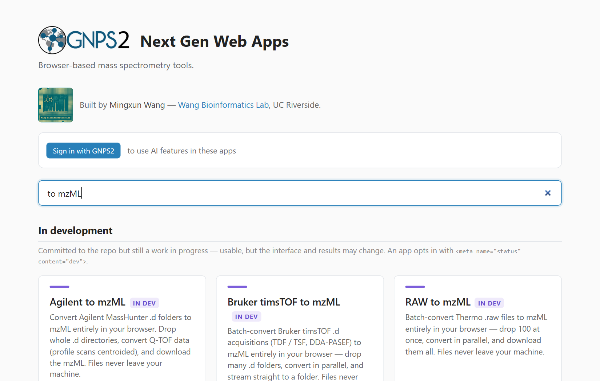
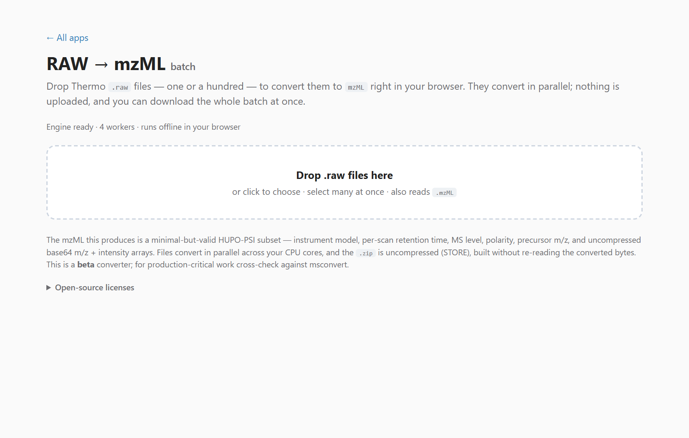
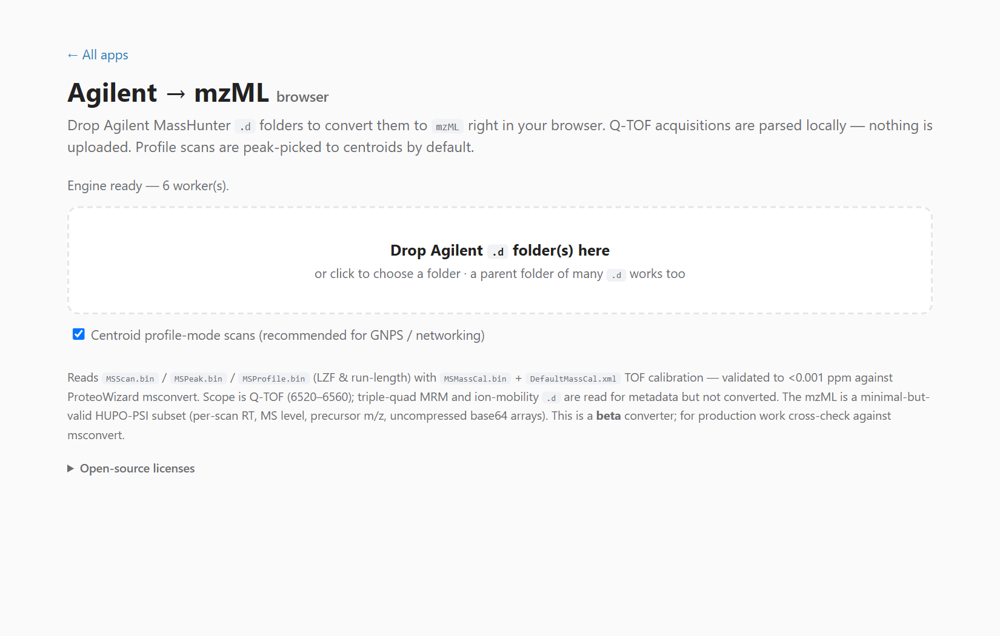
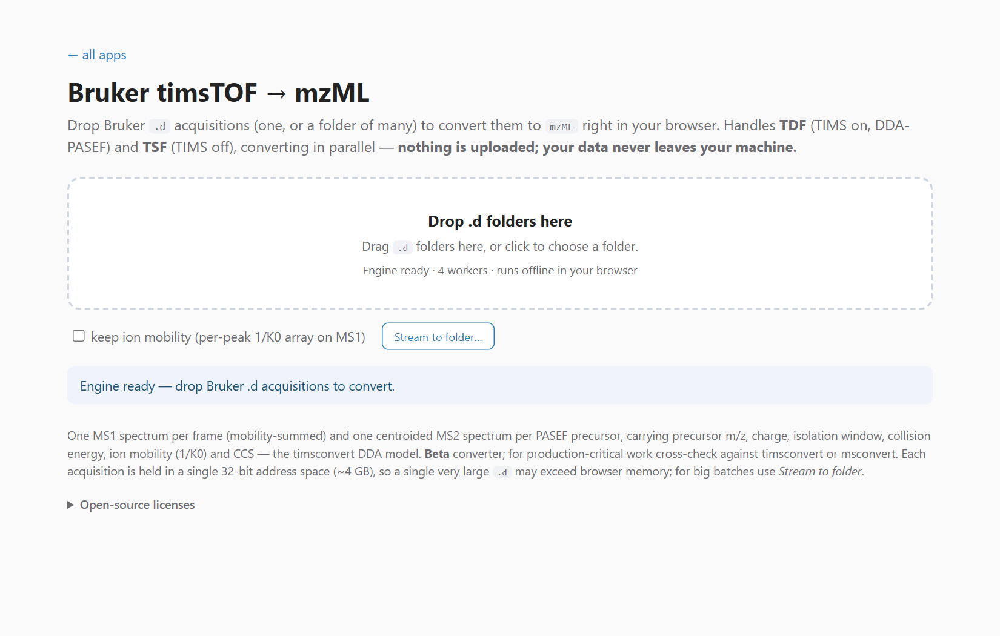
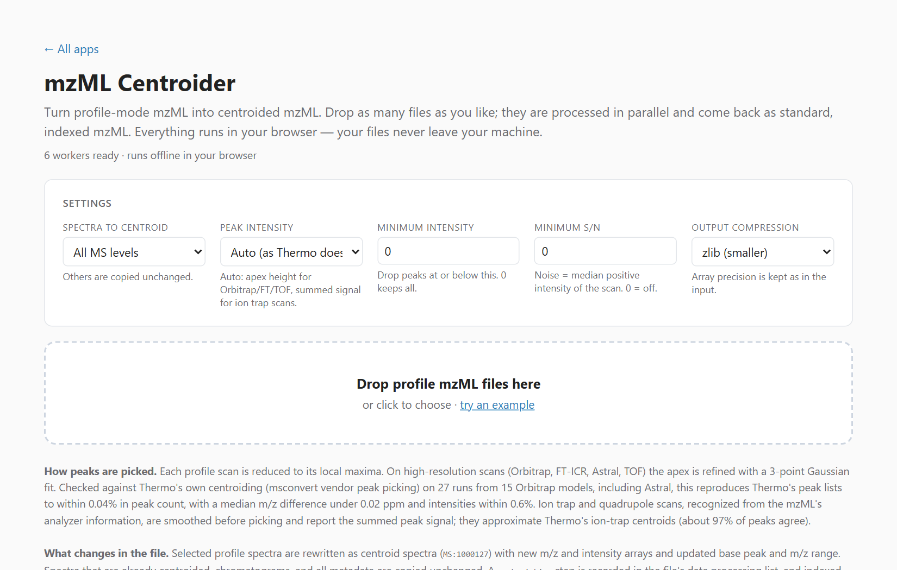
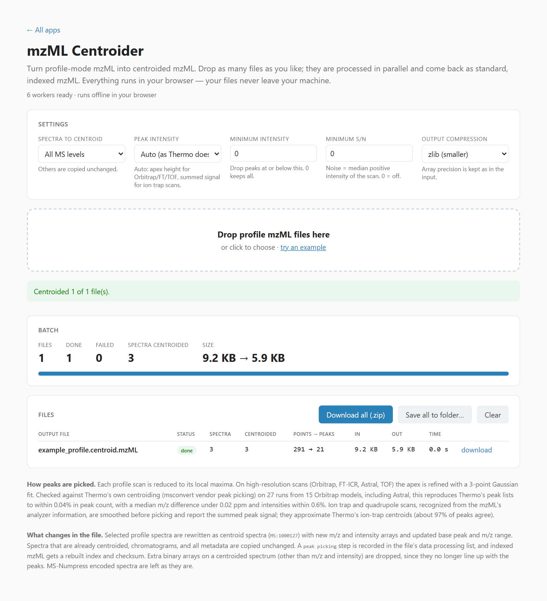
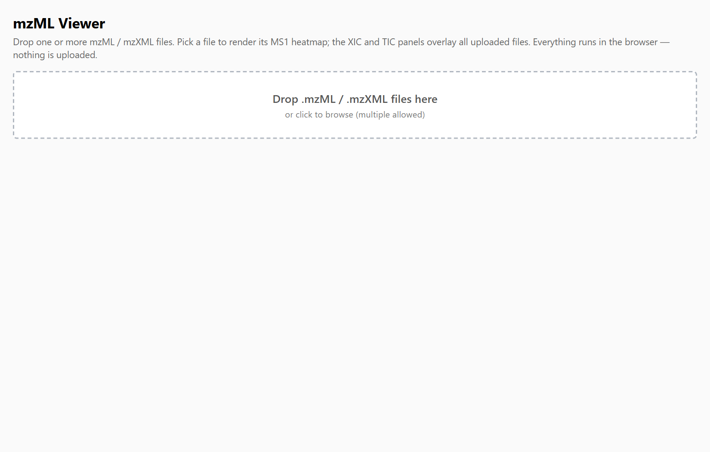

!!! info "Supported Formats at GNPS2"
    GNPS2 supports mzXML, mzML, and mgf formats for analysis. Our tools do NOT support mzData, xml, raw, RAW, wiff, scan, d, and cdf formats. If some of your files are in these formats, please use the following guide to convert them to open formats supported by GNPS2.

!!! danger "Your data must be centroided"
    GNPS2 workflows, such as molecular networking, FBMN, and library search, need **centroided** MS/MS data. Profile-mode data gives poor or empty results, and often no error explains why.

    Whatever method you use to convert your files, make sure the result is centroided:

    - **Web apps (Easy):** after converting, run any profile-mode files through the [mzML Centroider](#centroiding-profile-mzml). See [Is my data centroided?](#is-my-data-centroided) below.
    - **MSConvert (Traditional):** add the **Peak Picking** filter, with **Vendor** checked, as the *first* filter. See [Conversion with MSConvert](#conversion-with-msconvert).

## Data Conversion (Easy)

The [GNPS2 Next Gen Web Apps](https://apps.gnps2.org/) site has converters that turn vendor files into mzML **inside your web browser**. Nothing to install, it works on Windows, macOS, and Linux, and **your files never leave your computer**, because nothing is uploaded to a server.

Pick the app for your instrument vendor:

| Vendor | File Format | App |
| ------ | ----------- | --- |
| ThermoFisher | .raw | [RAW to mzML](https://apps.gnps2.org/raw_to_mzml2) |
| Agilent (Q-TOF) | .d folder | [Agilent to mzML](https://apps.gnps2.org/agilent_to_mzml) |
| Bruker timsTOF | .d folder | [Bruker timsTOF to mzML](https://apps.gnps2.org/bruker_tims_to_mzml) |
| Any (profile-mode mzML) | .mzML | [mzML Centroider](https://apps.gnps2.org/mzml_centroider) |

To browse all the converters, open [apps.gnps2.org](https://apps.gnps2.org/) and type `to mzML` in the search box:

!!! warning "Beta converters"
    These apps are marked **IN DEV**. They are already usable, but the interface may change. For production-critical work, spot-check a few converted files against MSConvert (see [Data Conversion (Traditional)](#data-conversion-traditional)). If a conversion fails or looks wrong, let us know by [contacting us](contact.md).

### Is my data centroided?

Converting and centroiding are two separate steps. Some converters centroid for you, and others keep your data as it was acquired:

| App | Centroids for you? | What to do |
| --- | ------------------ | ---------- |
| [RAW to mzML](https://apps.gnps2.org/raw_to_mzml2) | Not guaranteed | If your Thermo method acquired any scans in **profile** mode (common for Orbitrap MS1), run the output through the [mzML Centroider](#centroiding-profile-mzml) |
| [Agilent to mzML](https://apps.gnps2.org/agilent_to_mzml) | Yes, when **Centroid profile-mode scans** is checked (the default) | Leave the box checked |
| [Bruker timsTOF to mzML](https://apps.gnps2.org/bruker_tims_to_mzml) | Yes, MS/MS spectra are centroided | Nothing extra |

If you are not sure, run your mzML files through the [mzML Centroider](#centroiding-profile-mzml) anyway. Spectra that are already centroided are copied unchanged, so this step is safe for every file.

!!! tip "Use a desktop browser"
    Use a recent version of Chrome, Edge, or Firefox. The apps convert several files at once, one per CPU core, so large batches finish faster on a computer with more cores. Keep the tab open until the conversion finishes.

### Thermo .raw → mzML

App: [https://apps.gnps2.org/raw_to_mzml2](https://apps.gnps2.org/raw_to_mzml2)

1. Open the [RAW to mzML](https://apps.gnps2.org/raw_to_mzml2) app. Wait for the status line to say **Engine ready**.
2. Drag your Thermo `.raw` files onto the **Drop .raw files here** box, or click the box to pick them. You can select many files at once (100 or more is fine).
3. The files convert in parallel, and the progress shows on the page.
4. When they are done, download the mzML files. You can download the whole batch at once as a `.zip` file.

!!! info "Centroiding Thermo data"
    If your Thermo data was acquired in profile mode, run the converted mzML files through the [mzML Centroider](#centroiding-profile-mzml) before using them in GNPS2. Molecular networking needs centroided data.

### Agilent .d → mzML

App: [https://apps.gnps2.org/agilent_to_mzml](https://apps.gnps2.org/agilent_to_mzml)

1. Open the [Agilent to mzML](https://apps.gnps2.org/agilent_to_mzml) app. Wait for the status line to say **Engine ready**.
2. Leave **Centroid profile-mode scans** checked. This is recommended for GNPS2 and molecular networking.
3. Drag your Agilent `.d` folders onto the **Drop Agilent .d folder(s) here** box, or click the box to choose a folder. To convert a whole batch at once, pick a parent folder that contains many `.d` folders.
4. When the conversion finishes, download the mzML files.

!!! note "Supported Agilent instruments"
    The converter supports Agilent **Q-TOF** data (6520–6560 series). Triple-quad (MRM) and ion-mobility `.d` files are not converted. For those, use [MSConvert](#conversion-with-msconvert). See also our [Agilent conversion guide](agilent_conversion.md).

### Bruker timsTOF .d → mzML

App: [https://apps.gnps2.org/bruker_tims_to_mzml](https://apps.gnps2.org/bruker_tims_to_mzml)

1. Open the [Bruker timsTOF to mzML](https://apps.gnps2.org/bruker_tims_to_mzml) app. Wait for the status line to say **Engine ready**.
2. Optional: check **keep ion mobility** to add each peak's 1/K0 value to the MS1 spectra. You can leave it unchecked for a standard GNPS2 analysis.
3. Optional, for large batches: click **Stream to folder…** and pick a folder on your computer. The mzML files are then written straight to that folder instead of being kept in browser memory.
4. Drag your `.d` folders onto the **Drop .d folders here** box, or click it to choose a folder. You can drop one acquisition or a folder of many.
5. When the conversion finishes, download the mzML files, or find them in the folder you picked in step 3.

!!! note "Supported Bruker data"
    The converter handles timsTOF **TDF** (TIMS on, DDA-PASEF) and **TSF** (TIMS off) data. MS2 spectra are centroided. A single very large `.d` acquisition (over ~4 GB) may not fit in browser memory. In that case, use [timsconvert](https://github.com/gtluu/timsconvert) or MSConvert. For other Bruker instruments, see [Data Conversion (Traditional)](#data-conversion-traditional).

### Centroiding Profile mzML

App: [https://apps.gnps2.org/mzml_centroider](https://apps.gnps2.org/mzml_centroider)

Use this app if you already have mzML files, but they are in profile mode. For example, files exported from Thermo profile data or files converted by MSConvert without peak picking. GNPS2 workflows need centroided data.

1. Open the [mzML Centroider](https://apps.gnps2.org/mzml_centroider) app.
2. Review the **Settings**. The defaults (**All MS levels**, **Auto** peak intensity, minimum intensity `0`, minimum S/N `0`, **zlib** compression) work well for most data.
3. Drag your profile `.mzML` files onto the **Drop profile mzML files here** box, or click it to choose them. To see how the app works first, click **try an example**.
4. The **Batch** panel shows the progress. The **Files** table lists each output file, with how many spectra were centroided.
5. Click **Download all (.zip)**, **Save all to folder…**, or the **download** link on each row.

### Check Your Converted Files

Before you start a GNPS2 analysis, check that the converted files look right. Drop them into the [mzML / mzXML Viewer](https://apps.gnps2.org/mzml_viewer). It shows an MS1 heatmap, overlays the total ion chromatograms (TICs) of all your files, and can extract ion chromatograms (XICs). It also runs entirely in your browser.

If everything looks good, [upload your files](fileupload.md) to GNPS2.

## Data Conversion (Traditional)

The .mzXML or .mzML formats are strongly preferred and will be discussed below.

| Vendor        | Instrument Software           | File Format  | Recommended Converter | Notes |
| ------------- |-------------| -----| ----- | ----- |
| AB Sciex      | Analyst | .wiff | MSConvert | verified |
| Agilent      | MassHunter      |   .d | MSConvert | verified (with issues with scan number export) |
| Bruker | DataAnalysis/Compass      |   .d | CompassXport | This conversion is through the DataAnalysis software |
| ThermoFisher | Xcalibur      |    .raw/.RAW | MSConvert | verified |
| Waters | MassLynx      |    .raw | MSConvert is for full scan/DDA datasets. [Symphony](http://www.waters.com/waters/en_US/informatics,-data_pipeline/nav.htm?cid=134893896&locale=en_US) is for other modes such as MSe/SONAR/HDMSe/HD-DDA | See more informations about the procedure in [this Water Technology Brief](https://www.waters.com/webassets/cms/library/docs/720006415en.pdf) |
| Shimadzu | | .lcd | MSConvert | |

For problems with MSConvert, please contact the ProteoWizard [developers](http://proteowizard.sourceforge.net/contact.shtml).

If you are a vendor and think there are better methods to convert your files to work with GNPS2, let us know by [contacting us](contact.md).

### Conversion with MSConvert

Download and install ProteoWizard from [here](http://proteowizard.sourceforge.net/downloads.shtml).

!!! info 
    Make sure to choose a Windows-compatible version (includes vendor reader support). You must also have .NET [Framework 3.5 SP1](http://www.microsoft.com/en-us/download/details.aspx?id=22) and [4.0](http://www.microsoft.com/en-us/download/details.aspx?id=17851) installed.

After installation, from the Start Menu, click the ProteoWizard folder and open MSConvert.

- Click Browse and select file(s) for conversion. Then click Add to add them to the MSConvert workflow.

- Choose an Output Directory

- Under Options, choose mzML (prefered) or mzXML for output format, 32-bit for binary encoding precision and uncheck Use zlib compression.

- Under filters, choose Peak Picking with Vendor checked, in order to centroid the data. Indicate MS-Levels 1-2. Click Add to add the filter.

???+ danger Peak Peaking Filter Order
    Make sure the PeakPicking filter is the first filter in the list (top position), otherwise the conversion will not be centroided!
    

- Save the parameters for the next conversion. This will save you some time and prevent misconfiguration. In Presets (left bottom), click on Save Presets, and select "Save as default for the format".

- Click on Start.  Check your folder for the new .mzML/.mzXML files. Verify that these files open properly in Insilicos or [TOPP View (OpenMS)](http://www.openms.de/).

## Page Contributors

{{ git_page_authors }}
